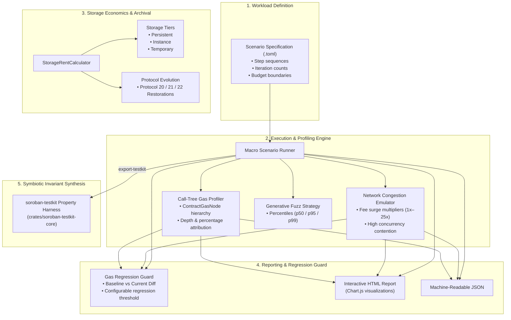

# Soroban Bench

[](https://github.com/stellar-crucible/soroban-bench/actions/workflows/ci.yml)
[](https://github.com/stellar-crucible/soroban-bench/actions/workflows/security.yml)
[](https://stellar-crucible.github.io/soroban-bench/)
[](https://github.com/stellar-crucible/soroban-bench/releases/latest)
[](LICENSE)
[](https://www.rust-lang.org)

Continuous macro-benchmarking, nested call-tree gas profiling, storage rent projections, and regression tracking for [Soroban](https://developers.stellar.org/docs/smart-contracts) smart contracts on the Stellar network.

Part of the **Stellar Crucible** smart contract engineering triad:
- [**soroban-testkit**](https://github.com/stellar-crucible/soroban-testkit) — Unit test harnesses, property test strategies, and mock environments.
- [**soroban-guard**](https://github.com/stellar-crucible/soroban-guard) — Static AST security auditing and testkit invariant synthesizer.
- [**soroban-bench**](https://github.com/stellar-crucible/soroban-bench) — Macro-benchmarking, gas regression baselines, and storage rent simulations.

---

## Why Soroban Bench?

Building high-throughput, mission-critical smart contracts on Stellar requires strict resource predictability:

1. **Host-Metered Resource Caps**: Soroban enforces hard limits on CPU instructions, memory allocations, and ledger footprint sizes per transaction. A minor code change or dependency upgrade can cause a 10% gas increase, pushing contract interactions over network limits and causing user transactions to fail unexpectedly.
2. **State Archival & Storage Rent Economics**: Unlike perpetual storage blockchains, Soroban charges continuous ledger rent based on entry size, storage tier (**Persistent**, **Instance**, or **Temporary**), and Time-To-Live (TTL). Without automated rent forecasting, protocols risk deploying contracts with unsustainable operating expenses or sudden entry expirations.
3. **Cross-Contract Call Opacity**: Modern decentralized finance protocols route calls across multiple contracts (e.g. liquidity routers calling token vaults and price oracles). Standard test runners only report total transaction gas, leaving developers unable to identify which sub-invocation caused a CPU bottleneck.
4. **Network Congestion & Fee Surges**: Under heavy ledger traffic, network fee multipliers spike (up to 25x), and write contention on shared keys triggers transaction delays. Isolated single-threaded tests cannot simulate performance under realistic concurrent traffic.

---

## How It Works

Soroban Bench provides an integrated benchmarking, profiling, and rent estimation pipeline:



### Detailed Execution Stages

1. **Declarative Workload Modeling (`TOML`)**: Scenarios define multi-step contract workflows specifying method sequences, iteration counts, and maximum expected CPU/memory bounds.
2. **Call-Tree Gas Profiling (`ContractGasNode`)**: Tracks nested sub-invocations, attributing CPU instructions and memory consumption across call depths (`0` = root, `1` = direct call, `2` = deep invocation) and calculating exact percentage attribution.
3. **Network Congestion Simulation**: Emulates ledger fee surges (1.0x to 25.0x) and concurrent caller contention to estimate latency, peak CPU, and collision rates under peak traffic.
4. **Protocol-Aware Storage Rent Calculator**: Evaluates ledger entry sizes across Persistent, Instance, and Temporary tiers to project 30, 90, and 365-day retention fees, as well as Protocol 20, 21, and 22 archival restoration costs.
5. **CI Regression Guard**: Compares current metrics against a committed baseline (`.benchmarks/baseline.json`), failing CI when CPU or memory consumption regresses beyond a specified threshold (e.g., 5.0%).
6. **Symbiotic Invariant Export (`export-testkit`)**: Automatically converts scenario budgets and execution invariants into executable `soroban-testkit` property test harnesses.

---

## Capabilities & Feature Matrix

| Feature | Description | Primary CLI Subcommand |
|---|---|---|
| **Macro Workloads** | Multi-step sequential smart contract user journeys | `soroban-bench run <scenario.toml>` |
| **Call-Tree Profiling** | Hierarchical cross-contract sub-invocation gas attribution | `soroban-bench profile <scenario.toml>` |
| **Network Congestion** | Fee surge multipliers (1x–25x) and contention emulation | `soroban-bench simulate <scenario.toml>` |
| **Rent Projection** | 30 / 90 / 365-day TTL retention and state archival fees | `soroban-bench rent --bytes <n>` |
| **Regression Guard** | Percentage difference check against baseline metrics in CI | `soroban-bench diff --baseline ...` |
| **Testkit Export** | Compiles scenario budgets into runnable property test suites | `soroban-bench export-testkit` |

---

## Quickstart & CLI Usage

### Installation

```bash
cargo install --path crates/soroban-bench-cli
```

### 1. Running a Scenario

Define a scenario file (e.g., `scenarios/swap_pool.toml`):

```toml
name = "liquidity-pool-stress"
description = "Simulate 500 AMM swaps under liquidity constraints"

[[steps]]
name = "deposit-liquidity"
contract_method = "deposit"
iterations = 50
expected_max_cpu = 2000000

[[steps]]
name = "sequential-swaps"
contract_method = "swap"
iterations = 500
expected_max_cpu = 1500000
```

Execute and generate an interactive standalone HTML report:

```bash
soroban-bench run scenarios/swap_pool.toml --format html --output report.html
```

Or save metrics as JSON for regression tracking:

```bash
soroban-bench run scenarios/swap_pool.toml --output current_metrics.json
```

### 2. Cross-Contract Gas Profiling

Profile nested sub-invocations to locate expensive contract dependencies:

```bash
soroban-bench profile scenarios/swap_pool.toml
```

Output:
```text
Profiling Cross-Contract Gas Attribution: liquidity-pool-stress

Execution Tree for Step `sequential-swaps`:
▪ [0] PrimaryContract::swap (75000000 CPU instructions, 4000000 bytes mem, 100.0%)
  └── [1] TokenVault::transfer_checked (32500000 CPU instructions, 1500000 bytes mem, 60.0%)
    └── [2] TokenLedger::debit (12500000 CPU instructions, 600000 bytes mem, 16.7%)
  └── [1] PriceOracle::get_latest_price (17500000 CPU instructions, 750000 bytes mem, 23.3%)
  Cumulative CPU: 137500000 instructions
```

### 3. Simulating Network Congestion & Fee Surges

Simulate contract behavior under peak network congestion:

```bash
soroban-bench simulate scenarios/swap_pool.toml --multiplier 10.0 --concurrency 50
```

### 4. Storage Rent & Archival Restoration

Calculate retention fees across tiers and Stellar protocol versions:

```bash
soroban-bench rent --bytes 2048 --tier persistent --ttl 100000 --protocol 22
```

### 5. Regression Diffing in CI

Compare metrics from the current build against a committed baseline:

```bash
soroban-bench diff --baseline baseline.json --current current_metrics.json --threshold 5.0
```

---

## Symbiosis with `soroban-testkit`

`soroban-bench` and `soroban-testkit` form a closed-loop verification cycle. Real-world macro scenarios benchmarked in `soroban-bench` can be exported directly into `soroban-testkit` property test invariants:

```bash
soroban-bench export-testkit scenarios/swap_pool.toml --output tests/benchmark_invariant.rs
```

Generated code automatically validates resource budgets inside the standard `soroban-testkit` testing pipeline:

```rust
//! Auto-generated by soroban-bench export-testkit
//! Verifies budget boundaries in soroban-testkit property tests.

#![cfg(test)]

use soroban_sdk::Env;
use soroban_testkit::budget::BudgetSnapshot;

#[test]
fn test_scenario_budget_invariants() {
    let env = Env::default();
    let snapshot = BudgetSnapshot::take(&env);

    // Step: deposit-liquidity (50 iterations on `deposit`)
    assert!(snapshot.cpu_instructions() <= 2000000, "CPU exceeded for deposit-liquidity");

    // Step: sequential-swaps (500 iterations on `swap`)
    assert!(snapshot.cpu_instructions() <= 1500000, "CPU exceeded for sequential-swaps");
}
```

---

## GitHub Actions CI Integration

Add performance regression gating to your pull request workflows:

```yaml
name: Gas Regression Gate

on:
  pull_request:
    branches: [main]

jobs:
  benchmark-gate:
    runs-on: ubuntu-latest
    steps:
      - uses: actions/checkout@v4
      - uses: dtolnay/rust-toolchain@stable
      - name: Build soroban-bench
        run: cargo build --release --bin soroban-bench
      - name: Run PR benchmark scenario
        run: ./target/release/soroban-bench run scenarios/main.toml --output pr_metrics.json
      - name: Compare with baseline
        run: ./target/release/soroban-bench diff --baseline .benchmarks/baseline.json --current pr_metrics.json --threshold 5.0
```
